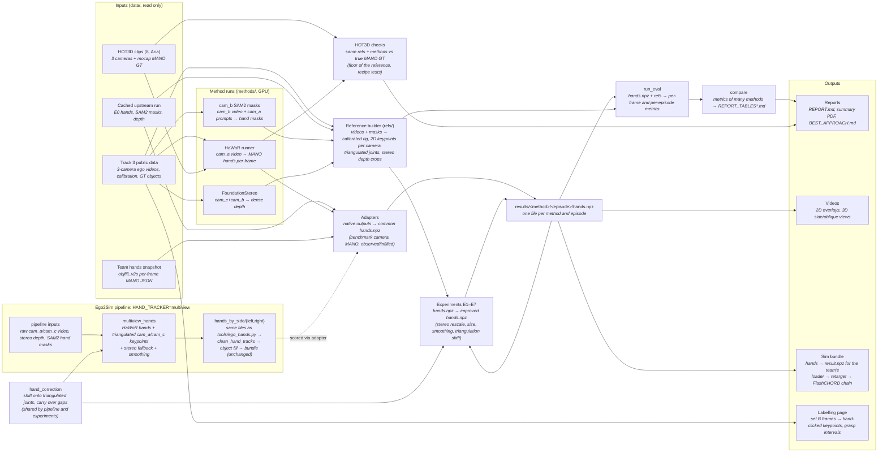

# handtracking: architecture overview

How the pieces in `handtracking/` fit together. Module-level detail: [handbench/ARCHITECTURE.md](handbench/ARCHITECTURE.md).
How to use them: [README.md](README.md); current best approach: [BEST_APPROACH.md](BEST_APPROACH.md).

## Blocks

| Block | What it does | In | Out |
|---|---|---|---|
| Track 3 public data | the 20 public episodes: ego videos (cam_a colour, cam_b / cam_c mono), factory calibration, GT object poses | – | `data/track3` (link) |
| Cached upstream run | the upstream ego pipeline already run on all episodes (WiLoR, SAM2, HaMeR, MoGe) | – | `data/cache/<ep>` (copied / linked) |
| Team hands snapshot | the team's current hands (`objfill_v2s`), copied read-only for comparison | `/home/rborah/v2d/ego2sim` | `data/team_objfill_v2s` |
| HOT3D clips | 8 Aria clips with true hand poses from motion capture | Hugging Face | `data/hot3d` |
| HaWoR runner | runs HaWoR (CVPR 2025) on cam_a (Track 3) or the Aria RGB view (HOT3D), one worker per GPU | video frames | `data/hawor`, `data/hot3d_hawor` (`export.npz`) |
| cam_b SAM2 masks | SAM2 video segmentation on cam_b, prompted from cam_a | cam_b video, cam_a masks, stereo | `refs/<ep>/masks_b` |
| FoundationStereo | learned stereo depth, an alternative to SGBM | cam_c + cam_b video | `refs/<ep>/stereo_fs.npz` |
| Reference builder | calibrates the rig, detects 2D hand keypoints in each camera, gates them with masks, triangulates them, builds stereo depth | videos, masks | `refs/` (`rig.json`, `kp2d`, `kp_gate`, `tri`, `stereo`) |
| Adapters | convert every hand source into the common format, in the benchmark camera | native outputs | `results/<method>/<ep>/hands.npz` |
| Experiments E1–E7 | benchmark variants made from existing methods (stereo rescale, shared size, smoothing, verifier, triangulation shift); the labels are benchmark row names only | `hands.npz`, refs | new `hands.npz` |
| run_eval | scores one method on one set | `hands.npz`, refs | `per_frame_*.csv`, `per_episode_*.csv`, `metrics_*.json` |
| compare | side-by-side tables, own frames and common frames, optional episode subset | metrics of several methods | `results/REPORT_TABLES*.md` |
| Reports | human write-ups of the results | tables, figures | `results/REPORT.md`, `report/*.pdf`, `BEST_APPROACH.md` |
| Videos | overlays in cam_a / cam_b, 3D side and oblique views | `hands.npz`, videos | `results/overlays/*.mp4` |
| Sim bundle | packs hands into the bundle format of the team's sim chain | `hands.npz`, stereo | `sim/<clip>/bundle` |
| Pipeline hand stage (`multiview_hands`) | multi-view hand tracker as a drop-in for `tools/ego_hands.py` ([README.md](README.md), Usage) | raw cam_a / cam_c videos, stereo dir, SAM2 hand masks | `hands_by_side/{left,right}` |
| hand_correction | shifts single-camera hands onto triangulated keypoints and carries the shift across gaps; shared by the pipeline stage and the benchmark experiment | joints, triangulated joints | corrected joints |
| Labelling page | HTML tool for hand-clicked keypoints and grasp intervals (set B) | frames | `labeling/`, `refs/setB.json` |
| HOT3D checks | the same reference protocol and correction recipes, scored against true hands | HOT3D clips, HaWoR | `results/hot3d_*.json` |

## Folders

| Folder | Content | In git |
|---|---|---|
| `handbench/` | all code (Python package) | yes |
| `data/` | inputs, caches, method raw outputs | no |
| `refs/` | references; small summary files are tracked | partly |
| `results/` | per-method metrics (tracked), `hands.npz` and videos (not tracked) | partly |
| `methods/` | third-party method code and their venvs (HaWoR, EgoFound3R, HOT3D toolkit) | no |
| `assets/` | MANO (licensed) and detector models | no |
| `report/` | LaTeX summary, figures, figure script | yes |
| `sim/`, `labeling/`, `logs/` | sim bundles, labelling page + images, run logs | no |
| top level | `README.md` (usage), `BEST_APPROACH.md` (recommendation, results, limits), `ARCHITECTURE.md` (this file) | yes |
