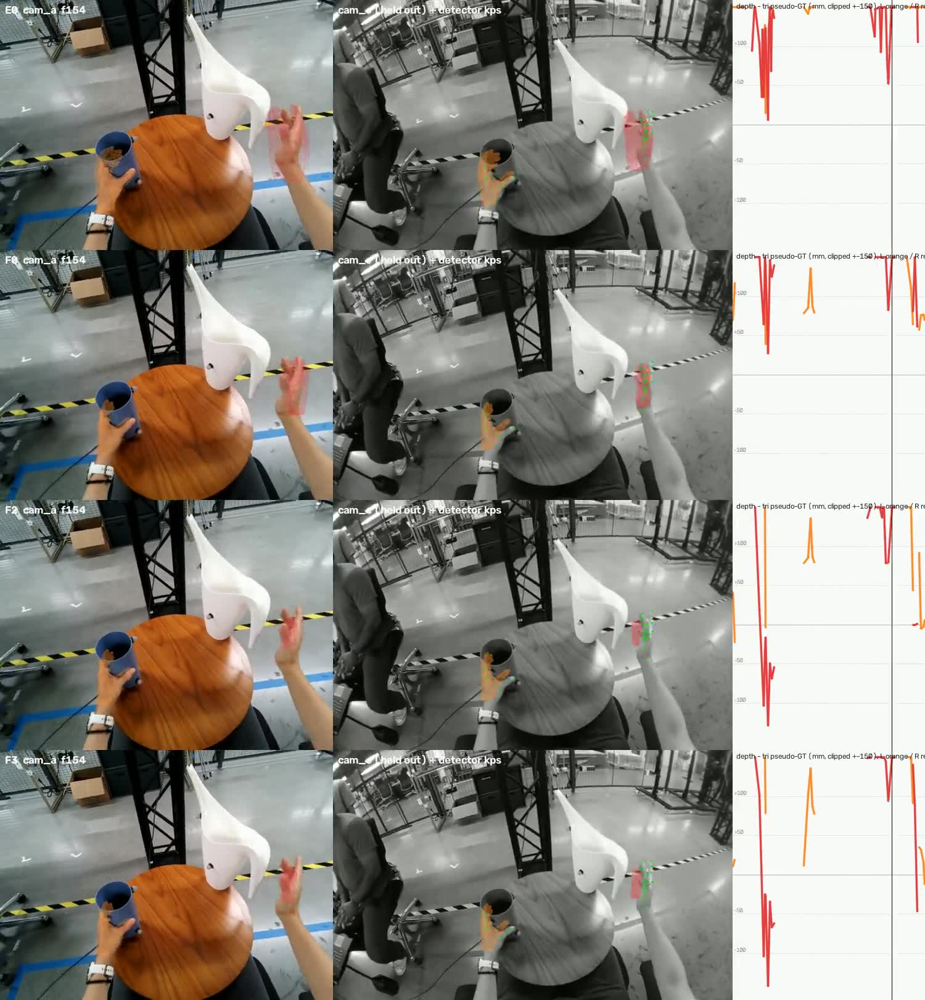
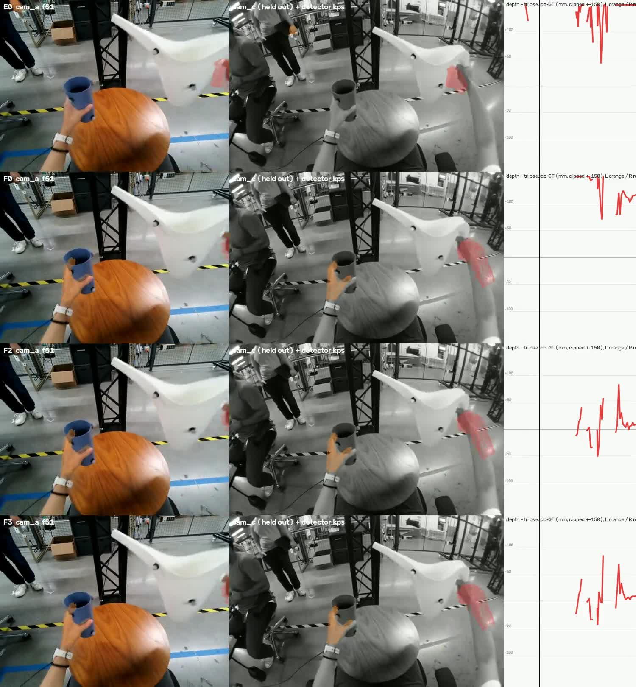
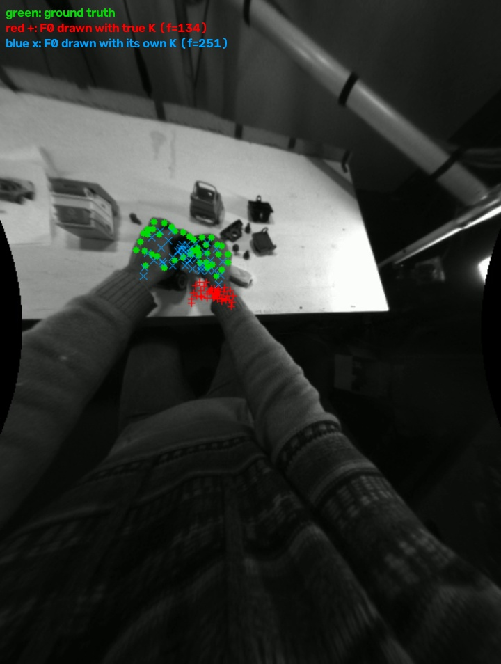

# Summary

We compared four ways of getting 3D hands from egocentric video, on three test sets.

- **E0** is the V2D baseline: WiLoR finds hands, SAM2 tracks them, HaMeR fits a MANO hand per frame, and the hand is
  moved to MoGe-2 monocular depth.
- **F0** replaces that whole hand stage with **EgoFound3R**, one model that outputs metric 3D hands from monocular
  video.
- **F2** is F0 plus a correction from a second camera: 2D keypoints in the input camera and one extra camera are
  triangulated, and each hand is translated (no rotation, no scale) onto them.
- **F3** is F2 plus temporal smoothing.

Main results (3D joint error, mm, lower is better; Track 3 uses held-out-camera metrics because it has no true 3D):

| | E0 | F0 | F2 | F3 |
|---|---|---|---|---|
| **AssemblyHands** (true 3D, unseen) | 231 | 159 | 54.3 | **53.0** |
| **HOT3D** (true 3D, *seen in EgoFound3R training*) | 131 | 36.8 | **28.1** | 28.4 |
| **Track 3** held-out cam_c PCK@10 px (higher is better) | 0.110 | 0.137 | 0.229 | **0.239** |
| Track 3 held-out cam_c IoU (higher is better) | 0.365 | 0.399 | 0.416 | **0.419** |

What each step adds:

1. **F0 vs E0.** EgoFound3R places hands much closer to the right depth than E0, which puts them 12–26 cm too far
   on every set. Hand pose (shape after alignment) is about the same.
2. **F2 vs F0.** The triangulated shift is the largest single gain on every set. It removes most of the remaining
   depth bias (Track 3 +108 → +20 mm, AssemblyHands +85 → +7 mm). It also fixes EgoFound3R's wrong focal length on
   AssemblyHands' very wide lens.
3. **F3 vs F2.** Smoothing mostly reduces jitter (Track 3 14.0 → 5.3 m/s², AssemblyHands 3.7 → 1.6) with little
   change in accuracy (±1 mm).

On Track 3, our earlier stereo-based method (E8fallback, from the handbench study) is still better on the held-out
camera than F3 (cam_c PCK 0.348 vs 0.239).

**Known camera intrinsics.** Giving EgoFound3R the true focal length (F0-known-K) and then applying F2/F3 on top
helps on normal lenses (HOT3D: F2-known-K 26.1 mm, the best result; Track 3: F3-known-K cam_c PCK 0.245, the best
EgoFound3R variant, but only +0.006 over F3) and hurts on the extreme wide-angle AssemblyHands lens (57.8 vs 50.6 mm
on common frames), where EgoFound3R with the true focal puts hands about 13 cm too far. EgoFound3R also outputs hands at only 10 fps, so it covers half of Track 3's
frames and a third of HOT3D's.

# Methods

| ID | What it is |
|---|---|
| E0 | video_to_data@8c778f9 hand stage **plus the uncommitted HaMeR patch the cached Track 3 run used** (HaMeR crop on the WiLoR hand box, invalid depth pixels dropped before alignment, one hand scale for both hands capped at 1.25; `tools/upstream_patches/`). Run without Docker by `tools/run_e0_standalone.py --cached-track3-settings`; on Track 3 it reproduces the cached run within 3 % on every primary metric. Plain 8c778f9 gives the same medians but its depth alignment sometimes snaps a hand to the background (Track 3 ep 41 jitter 32.6 vs 12.6 m/s²). |
| F0 | EgoFound3R@264f4df, checkpoint `EgoFound3R.pt`, input resized keeping aspect ratio (384×512 for 4:3). Uses its own predicted focal length. Its 21 joints are scored; MANO is fitted to its 778 vertices for compatibility (residual median 2.4–3.6 mm per hand-frame). |
| F2 | F0 + per frame and hand: if ≥ 4 joints are triangulated (detector score ≥ 0.5, reprojection < 3 px in every view used), translate the hand by the mean (triangulated − F0) joint offset. Otherwise reuse the last shift for up to 30 frames, otherwise keep F0. **Added guard:** a shift that would put any joint < 5 cm in front of the camera is not applied (see failure case 2). |
| F3 | F2 + Savitzky–Golay smoothing of joints and vertices, window 7, order 2 (handbench E1best settings), over runs of consecutive EgoFound3R frames (about 0.7 s at its 10 fps). |
| F0-known-K | Extra row: F0 given the true camera intrinsics (`--root-k-source external`). Not one of the four required methods. |
| F2-known-K, F3-known-K | Extra rows: F2 / F3 applied to F0-known-K (same keypoints, same rules). |

Keypoints for F2 use the same RTMPose-m hand detector and two-pass crops as the handbench Track 3 references. On the
ground-truth sets the crops are placed from F0's own hands, so no ground truth is used. Second camera: **Track 3**
cam_b (cam_c held out); **AssemblyHands** the second headset camera, 11.3 cm away; **HOT3D** the right mono SLAM
camera, 12.6 cm away (the left one is only 1.5 cm from the RGB camera). Triangulated joints are 17 mm (AssemblyHands)
and 15 mm (HOT3D) from the ground truth (median).

# Test sets

| | Frames scored | Input | Ground truth |
|---|---|---|---|
| **Track 3** (our domain) | 20 public episodes, 20.25 fps | colour cam_a, undistorted | none; triangulated RTMPose keypoints (about 20 mm from true joints) plus SAM2 hand masks in the held-out camera cam_c |
| **AssemblyHands** val | 8 clips × 300 frames (4 per subject, 2 subjects), 15 fps, 4,745 visible hand-frames | **monochrome** headset camera (as 3 identical channels), focal 134 px (about 120° across), rotated upright | 3D keypoints from an external multi-camera rig |
| **HOT3D** Aria | the 7 clips from the earlier study, 150 frames each, 30 fps, 1,456 visible hand-frames | colour camera, fisheye re-projected to an upright pinhole (f = 600) | motion-capture MANO hands |

**Overlap with training data.** EgoFound3R was trained on H2O, **HOT3D-Aria**, OakInk-v2, TACO, HOI4D, ARCTIC and
STERA-10M, and our HOT3D clips are from HOT3D's train split, so **every HOT3D number for F0–F3 is seen-domain**.
AssemblyHands and Track 3 are not in EgoFound3R's training data. HaMeR's training mix (`hamer/configs_hydra/data/mix_all.yaml`:
FreiHAND, InterHand2.6M, MTC, RHD, COCO-WholeBody, Halpe, MPII-NZSL, HO3D, H2O3D, DexYCB) contains neither
AssemblyHands nor HOT3D. WiLoR's paper lists the same sets plus its own WHIM data; we could not check its training
code. The RTMPose hand model (hand5) is trained on COCO-WholeBody-Hand, OneHand10K, FreiHAND, RHD and Halpe.

**Track 3 circularity.** The Track 3 3D reference is triangulated from cam_a, cam_b and cam_c keypoints. F2 and F3
use cam_a + cam_b keypoints, so their 3D error against that reference is partly circular. Their held-out numbers are
the cam_c ones: keypoint error, PCK@10 px and IoU against SAM2 masks.

# Results

Each table compares methods on their own scored hand-frames. Brackets give the change vs E0; **bold** is best. A
hand-frame is scored only where the hand is visible in the input camera and the method predicted it on that frame
(interpolated or gap-filled frames are never scored). Full tables, including common-frame comparisons, are in
`results/<set>/REPORT_TABLES.md`.

## Track 3 (20 episodes; pseudo-ground truth, noise floor about 20 mm)

Primary, held-out camera cam_c:

| method | cam_c kp (px) | cam_c PCK@10 | cam_c IoU | 3D err vs tri abc (mm)† | depth bias (mm)† | centred (mm) | jitter (m/s²) | bone std (mm) | coverage |
|---|---|---|---|---|---|---|---|---|---|
| E0 | 31.11 | 0.110 | 0.365 | 263.4 | +259.6 | 42.4 | 13.40 | **1.05** | **100 %** |
| F0 | 31.26 (+0.15) | 0.137 (+0.027) | 0.399 (+0.034) | 119.2 (−144.2) | +107.7 | 39.7 | 4.79 | 3.23 | 50.0 % |
| F2 | 30.22 (−0.89) | 0.229 (+0.119) | 0.416 (+0.051) | **62.3** (−201.1)† | **+20.3**† | 39.7 | 13.99 | 3.23 | 50.0 % |
| F3 | **29.23** (−1.88) | **0.239** (+0.130) | **0.419** (+0.054) | 62.5 (−200.9)† | +21.1† | **39.6** | **5.26** | 2.97 | 50.0 % |
| *F0-known-K* | *26.90* | *0.236* | *0.443* | *105.4* | *+93.2* | *39.7* | *4.78* | *3.25* | *50.1 %* |
| *F2-known-K* | *29.49* | *0.234* | *0.419* | *62.1*† | *+20.1*† | *39.7* | *13.78* | *3.25* | *50.1 %* |
| *F3-known-K* | *28.53* | *0.245* | *0.422* | *62.2*† | *+20.8*† | *39.6* | *5.16* | *2.98* | *50.1 %* |
| *E8fallback (handbench best, stereo)* | *23.92* | *0.348* | *0.437* | *47.5* | *+7.5* | *36.0* | *3.09* | *2.88* | *97.9 %* |

† F2/F3 are circular on these columns (they used cam_b keypoints that also built the reference). Rows in italics are
not part of the four-method comparison. Coverage: EgoFound3R predicts at 10 fps, so it gives a hand on half of the
20 fps frames; its own frames have a hand on almost every visible hand. PA-MPJPE is not available on Track 3 (handbench
reports the centred error, i.e. pose after removing translation). On the 2,767 hand-frames every method covers, the
ranking is the same (3D error E0 261, F0 119, F2 62, F3 62 mm).

F2 coverage on Track 3: own triangulation 48 %, carried shift 35 %, no correction 17 %, rejected by the guard < 0.1 %.

## AssemblyHands (8 clips, 2 subjects; true 3D; not in any method's training data)

| method | 3D err (mm) | median | depth | lateral | depth bias | pose (centred) | PA | 2D (px) | PCK@10px | jitter (m/s²) | bone std (mm) | coverage |
|---|---|---|---|---|---|---|---|---|---|---|---|---|
| E0 | 231.4 | 206.6 | 217.4 | 65.1 | +217.2 | 30.4 | **14.8** | 32.2 | 0.247 | 9.76 | **0.55** | **99.9 %** |
| F0 | 158.6 (−72.8) | 157.2 | 90.0 | 118.2 | +84.7 | 26.4 | 15.4 | 54.6 | 0.017 | 2.15 | 3.20 | 96.0 % |
| F2 | 54.3 (−177.1) | 37.3 | 33.4 | 38.1 | **+7.3** | 26.4 | 15.4 | 23.5 | 0.314 | 3.70 | 3.20 | 96.0 % |
| F3 | **53.0** (−178.4) | **36.7** | **32.2** | **37.6** | **+7.3** | **26.1** | 15.2 | **23.2** | **0.315** | **1.58** | 2.90 | 96.0 % |
| *F0-known-K* | *156.4* | *162.5* | *137.4* | *65.0* | *+126.0* | *27.3* | *15.6* | *22.7* | *0.132* | *2.55* | *3.07* | *73.8 %* |
| *F2-known-K* | *59.0* | *37.9* | *44.3* | *31.5* | *+15.1* | *27.3* | *15.6* | *16.3* | *0.404* | *3.84* | *3.07* | *73.8 %* |
| *F3-known-K* | *58.0* | *37.3* | *43.1* | *31.2* | *+15.2* | *27.1* | *15.5* | *16.1* | *0.406* | *1.75* | *2.89* | *73.8 %* |

On the 1,639 hand-frames all seven rows cover: E0 208, F0 165, F2 51.8, F3 **50.6**, F0-known-K 156, F2-known-K 58.9,
F3-known-K 57.8 mm (the known-K variants have better 2D, 16.0 vs 17.4 px, but keep F0-known-K's depth bias on frames
without their own triangulation). F2 coverage: own triangulation
57 %, carried 29 %, none 13 %, rejected 1 %.

**Per-joint offset.** The instructions ask for metrics after a fixed per-joint offset estimated on a held-out split
(here: fitted on the other subject, in the hand's own frame). For F3 this gives 52.2 mm (from 53.0): AssemblyHands' and
MANO's joint definitions differ by a few mm. For E0 and F0 the "offset" also absorbs part of their large global depth
error, which does not transfer between subjects (E0 2D error rises from 32 to 74 px), so it is not meaningful there.

**Why F0 is poor here.** These rectified headset cameras have a focal length of 134 px (about 120° across).
EgoFound3R predicts about 250 px (1.86× too long; on Track 3 and HOT3D its estimate is within 4 %). Its hands
project to the right pixels *with its own focal*, but in 3D they are squeezed towards the optical axis
(failure case 3). Giving it the true focal (F0-known-K) puts them in the right image place (2D 55 → 23 px) but too far
(depth bias +126 mm) and finds fewer hands (74 % coverage): on this lens, with grey input and 25–50 px hands, its
size-to-depth cues fail. F2 corrects position from triangulation whatever focal F0 assumed.

## HOT3D (7 clips; true 3D; **seen in EgoFound3R training**)

| method | 3D err (mm) | median | depth | lateral | depth bias | pose (centred) | PA | 2D (px) | PCK@10px | jitter (m/s²) | bone std (mm) | coverage |
|---|---|---|---|---|---|---|---|---|---|---|---|---|
| E0 | 130.6 | 122.9 | 124.1 | 29.1 | +122.2 | 27.3 | 8.6 | 36.8 | 0.144 | 21.79 | **0.14** | **100 %** |
| F0 | 36.8 (−93.8) | 32.1 | 30.3 | 16.8 | +11.4 | 11.9 | 8.5 | 23.4 | 0.225 | 3.08 | 2.00 | **100 %** |
| F2 | **28.1** (−102.5) | **22.9** | 21.3 | **14.8** | +3.0 | 11.9 | 8.5 | **22.3** | **0.262** | 3.65 | 2.00 | **100 %** |
| F3 | 28.4 (−102.2) | 23.7 | **20.2** | 16.4 | **+2.7** | **11.7** | **8.3** | 24.9 | 0.225 | **2.02** | 1.84 | **100 %** |
| *F0-known-K* | *31.1* | *26.2* | *27.4* | *11.0* | *+2.2* | *11.9* | *8.5* | *16.5* | *0.329* | *3.06* | *2.00* | *100 %* |
| *F2-known-K* | ***26.1*** | ***21.7*** | *20.8* | *12.3* | *+1.1* | *11.9* | *8.5* | *18.8* | *0.295* | *3.58* | *2.00* | *100 %* |
| *F3-known-K* | *26.5* | *22.2* | *19.8* | *14.0* | *+0.7* | *11.7* | *8.3* | *21.5* | *0.258* | *1.99* | *1.84* | *100 %* |

Coverage is over the frames each method predicts on: F0–F3 predict 514 of the 1,456 visible hand-frames (10 of 30
fps); E0 all of them. On those 514 common hand-frames the numbers are the same within 1 mm. F2 coverage: own 40 %,
carried 35 %, none 25 %. For reference, HaWoR (raw) scored 28.4 mm on all 1,433 hand-frames in the earlier study.

# Ablation reading

- **F0 (swap the hand stage).** The big effect is depth: E0's hands are placed 12–26 cm too far on every set (MoGe-2
  depth); EgoFound3R's bias is +108 mm on Track 3, +85 on AssemblyHands, +11 on HOT3D. Hand articulation (PA, centred
  error) is about the same as E0's; bone lengths vary more (2–3 mm std vs E0's fixed shape). It is far smoother (Track 3
  jitter 4.8 vs 13.4 m/s²). In the input image it is no better than E0 on Track 3 (cam_a 49 vs 42 px): its own focal
  estimate is 4 % short there, and F0-known-K fixes that (39 px, best cam_c IoU 0.443).
- **F2 (triangulated shift).** The largest gain everywhere: −57 mm on Track 3 (circular), −104 mm on AssemblyHands,
  −8.7 mm on HOT3D. It removes almost all depth bias on the ground-truth sets (+7 and +3 mm) and doubles cam_c PCK on
  Track 3 (0.137 → 0.229). Switching between own, carried and no shift makes it jumpy (Track 3 jitter 4.8 → 14.0).
- **F3 (smoothing).** Removes F2's jumps (Track 3 jitter 14.0 → 5.3, AssemblyHands 3.7 → 1.6, HOT3D 3.7 → 2.0) and
  slightly improves held-out 2D on Track 3. 3D error changes by ±1 mm. At EgoFound3R's 10 fps the 7-frame window spans
  0.7 s, which costs a little 2D accuracy on fast HOT3D motion (22.3 → 24.9 px).

# Compute (RTX 4090)

| method | model | torch peak alloc. (GiB) | nvidia-smi peak (GiB) | time |
|---|---|---|---|---|
| E0 | MoGe-2 (depth) | 10.4 | | 41–55 s per clip* |
| | WiLoR (detection + MANO) | 1.4 | | 15–28 s |
| | SAM2.1-L (masks) | 2.5 | | 10–17 s |
| | HaMeR (per frame) | 5.1 | | 20–22 s |
| | align + interpolate (CPU/GL) | – | | 6–11 s |
| | **E0 total** | **10.4** (max) | **12.8** | **100 s / 300 AssemblyHands frames (3.0 fps); 128 s / 150 HOT3D frames (1.2 fps)** |
| F0 | EgoFound3R (VGGT-Ω backbone) | **4.2** | **8.0** | forward 2–5 s per clip; whole pipeline 84–104 s per 150–300-frame clip (about 3 fps), plus overlay rendering |
| F0 | MANO fit to 778 vertices (CPU, optional) | – | – | 60–200 s per clip |
| F2 | RTMPose 2 views (CPU, 1 core per clip) | – | – | 154 s / 300 AssemblyHands frames; 37 s / 150 HOT3D frames; Track 3 reused handbench's keypoints |
| F2 | triangulation + shift (CPU) | – | – | < 1 s per clip |
| F3 | Savitzky–Golay (CPU) | – | – | < 0.1 s per clip |

\* E0 per-step times are medians over the AssemblyHands / HOT3D clips. Per method, peak = the largest of its models
(E0 10.4 GiB, F0–F3 4.2 GiB torch; 12.8 / 8.0 GiB nvidia-smi) and time = the sum. Full step times and peaks per run are in each run's `run_meta.json`.
On Track 3 (2028×1520, 299 frames) E0's steps took MoGe 150 s, WiLoR 80 s, SAM2 23 s, HaMeR 67 s and align 46 s, but
that run shared the GPU with another job for part of the time.

# Failure cases

**1. A wrong two-view triangulation (Track 3 ep 21, frames 154–156).** The right hand is half outside cam_a at the
top right. Its cam_a + cam_b keypoints triangulate consistently (< 3 px reprojection) but wrongly, and F2 moves the
hand 43 cm further away; the shift is then carried to frame 156. With only two views, a consistent wrong match
cannot be caught by reprojection error. Ep 21 is F3's worst episode (167 mm).

**2. A carried shift outlives F0's depth (Track 3 ep 22, frames 31–51).** At frame 31 F2 measured a −24 cm shift
(F0 had the right hand at 0.55 m, triangulation said 0.32 m). By frame 51 F0's own depth for that hand had jumped to
0.18 m, and carrying the old shift would have put the hand behind the camera. The added guard (no joint closer than
5 cm) rejects such shifts and keeps F0: 1 hand-frame on Track 3, 36 (1 %) on AssemblyHands, 0 on HOT3D.

**3. EgoFound3R's focal length on a very wide lens (AssemblyHands 9012-c07c, clip from frame 5770, frame 29).**
Green dots: ground truth. Blue ×: F0's joints drawn with its own focal (251 px), on the hands. Red +: the same 3D
joints drawn with the true focal (134 px), squeezed towards the image centre. That is F0's 3D error (lateral 118 mm).

# Videos

- Track 3 (input cam_a, held-out cam_c, depth vs reference plot; rows E0, F0, F2, F3):
  `results/track3/videos/ep23_E0_F0_F2_F3_camc.mp4` (F3's largest cam_c gain),
  `ep21_…` (failure case 1), `ep22_…` (failure case 2).
- AssemblyHands (input camera, second camera, ground-truth joints in green; rows E0, F0, F2, F3):
  `results/assemblyhands/videos/9012-c07c_005770_E0_F0_F2_F3.mp4`, `9081-c11b_000505_E0_F0_F2_F3.mp4`.

# Future work

- **Known intrinsics + shift (done, extra rows).** Best on HOT3D (26.1 mm); on Track 3 only +0.006 cam_c PCK over F3,
  and F0-known-K alone keeps the best cam_c keypoint error and IoU (the translation shift slightly disturbs its already
  good 2D placement); worse on AssemblyHands' extreme lens. Next: let the shift act only along the viewing ray when
  the 2D placement is already good.
- **A stronger F2 gate.** Use ≥ 3 views where available, or require the shift to agree with the previous one, to
  catch consistent-but-wrong two-view matches (failure case 1); re-check carried shifts against F0's own depth
  changes (failure case 2).
- **Full-rate output.** EgoFound3R predicts at 10 fps; scoring only those frames halves Track 3 coverage.
- **E1best** (E0 hands + SGBM stereo rescale + one size per hand + smoothing) on the ground-truth sets.
- **F1**: EgoFound3R + one stereo depth scale per video applied to its whole scene, gated on stereo coverage and
  stability.
- **HaWoR** (+ stereo / + triangulated shift) on the same sets.

# Reproducing

Commands per method and test set are in `handtracking/egofound/README.md`. Code: branch `egofound3r-eval`.
