# handbench: module architecture

How the modules of the `handbench` package depend on each other. Overview of the whole folder:
[../ARCHITECTURE.md](../ARCHITECTURE.md). Arrows point from a module to what it produces or feeds.

```mermaid
flowchart TB
  %% ================= core (pure NumPy / OpenCV; Mac-friendly)
  subgraph CORE["Core (no GPU, no torch)"]
    paths["paths<br/><i>folder layout, episodes, fps</i>"]
    calib["calib<br/><i>rig cameras: project, undistort, triangulate</i>"]
    mano["mano<br/><i>NumPy MANO: params → mesh + 21 joints</i>"]
    fit["fit<br/><i>Umeyama, refit MANO global pose to a mesh</i>"]
    format["format<br/><i>hands.npz: save / load / validate</i>"]
    render["render<br/><i>silhouettes + depth maps (OpenCV)</i>"]
    stereo["stereo<br/><i>SGBM / FoundationStereo → depth in cam_a</i>"]
    crops["crops<br/><i>perspective hand crops of fisheye images</i>"]
    refs_io["refs_io<br/><i>video frames, track ids, timestamps</i>"]
  end

  %% ================= datasets
  subgraph DS["datasets/"]
    base["base<br/><i>EpisodeRefs: what a dataset gives the metrics</i>"]
    v2d["v2d<br/><i>Track 3 refs: kp2d, gate, tri, stereo crops, masks</i>"]
    hot3d["hot3d<br/><i>HOT3D clips: Aria fisheye cameras, MANO GT</i>"]
  end

  %% ================= reference building
  subgraph REF["Reference building"]
    build_refs["build_refs<br/><i>keypoints per camera, gate, triangulate, stereo crops</i>"]
    build_masks_b["build_masks_b<br/><i>SAM2 hand masks on cam_b (GPU)</i>"]
    tools["tools/<br/><i>calib_check, sensitivity, stereo_check, convert_mano</i>"]
  end

  %% ================= method inputs
  subgraph AD["adapters/ + runners/"]
    v2d_up["adapters.v2d_upstream<br/><i>upstream camera → benchmark camera</i>"]
    up_hamer["adapters.upstream_hamer<br/><i>cached HaMeR records → E0, E0-refined</i>"]
    hawor_ad["adapters.hawor<br/><i>HaWoR export → E2 variants</i>"]
    team["adapters.team_objfill<br/><i>team objfill_v2s → TEAM-objfill_v2s</i>"]
    runners["runners.hawor_run / hawor_hot3d<br/><i>run HaWoR on both GPUs (methods/.venv-hawor)</i>"]
  end

  %% ================= experiments
  subgraph EX["experiments/"]
    e1["e1<br/><i>E1a-d: stereo align, shared size, smoothing, swaps</i>"]
    e4["e4<br/><i>per-frame quality verifier; drop / replace</i>"]
    e7["e7_tri<br/><i>shift onto a+c triangulated joints, carry, SGBM, smoothing</i>"]
    h3check["hot3d_check<br/><i>E1best recipe vs true GT</i>"]
    h3floor["hot3d_floor<br/><i>reference accuracy vs true GT</i>"]
    h3fusion["hot3d_fusion<br/><i>triangulation fusion vs true GT</i>"]
  end

  %% ================= evaluation + outputs
  subgraph EV["Evaluation"]
    metrics["metrics<br/><i>3D error, cam_b keypoints / IoU, jitter, coverage</i>"]
    run_eval["run_eval<br/><i>one method × set → CSV + JSON</i>"]
    compare["compare<br/><i>tables, common frames, episode subsets</i>"]
  end
  subgraph VZ["Outputs"]
    overlay["overlay<br/><i>2D overlay videos</i>"]
    viz3d["viz3d<br/><i>3D side / oblique comparison videos</i>"]
    sim["sim.export_bundle<br/><i>hands → sim chain bundle</i>"]
    pipe["pipeline.multiview_hands<br/><i>pipeline hand stage: HaWoR + triangulated keypoints + stereo</i>"]
    labeling["labeling/<br/><i>set B labelling page + importer</i>"]
  end
  tests["tests/<br/><i>format + synthetic metric checks</i>"]

  %% ---------------- edges
  calib --> stereo
  calib --> crops
  mano --> fit
  mano --> render

  tools --> calib
  crops --> build_refs
  stereo --> build_refs
  build_masks_b --> build_refs
  v2d_up --> build_refs
  build_refs --> v2d
  base --> v2d
  base --> hot3d

  v2d_up --> up_hamer
  runners --> hawor_ad
  up_hamer --> format
  hawor_ad --> format
  team --> format
  fit --> up_hamer
  fit --> hawor_ad

  format --> e1
  format --> e4
  format --> e7
  stereo --> e1
  build_refs --> e7
  e1 --> format
  e4 --> format
  e7 --> format

  hot3d --> h3check
  runners --> h3check
  build_refs --> h3floor
  hot3d --> h3floor
  h3check --> h3fusion
  h3floor --> h3fusion

  format --> run_eval
  v2d --> run_eval
  render --> metrics
  metrics --> run_eval
  run_eval --> compare

  format --> overlay
  format --> viz3d
  format --> sim
  crops --> labeling
  hcorr["hand_correction<br/><i>shift onto triangulated joints, carry</i>"]
  hcorr --> e7
  hcorr --> pipe
  build_refs --> pipe
  metrics --> tests
  format --> tests
```

## How to read it

* **Core** modules are plain NumPy / OpenCV and run anywhere (a Mac included). Everything else builds on them.
* Every hand source goes through an **adapter** into one format, `format.hands.npz`: per frame and hand, MANO
  parameters, 21 joints and the mesh in the benchmark camera (undistorted cam_a), with `observed` / `infilled` flags.
* **Experiments** read one or more `hands.npz` and write a new one, so every variant can be scored the same way.
* **Datasets** describe what the metrics may use: `v2d` serves the Track 3 references (`build_refs` output); `hot3d`
  serves HOT3D clips with true hand poses (used by the `hot3d_*` experiments, which score directly against GT).
* **run_eval** = one method on one dataset → per-frame CSV, per-episode CSV, `metrics.json`; **compare** turns many of
  those into tables.

## Modules at a glance

| Module | Role | Main inputs | Main outputs |
|---|---|---|---|
| `paths` | folder layout, episode list, real fps | – | paths |
| `calib` | rig model; project / undistort / triangulate | `refs/calib/rig.json` | camera objects |
| `mano` | NumPy MANO (matches manotorch to 4e-8 m) | `assets/mano_right.npz` | mesh, joints |
| `fit` | similarity fit, refit MANO global pose | meshes | MANO params |
| `format` | the common `hands.npz` + validator | arrays | file |
| `render` | silhouettes and depth maps without GL | mesh, camera | images |
| `stereo` | SGBM and FoundationStereo depth in cam_a | cam_c + cam_b frames | depth maps |
| `crops` | perspective crops of distorted images | image, rays | crop + px↔ray maps |
| `refs_io` | frame reading, hand-track ids, timestamps | videos, cache | frames, times |
| `build_refs` | keypoints, gate, triangulation, stereo crops | videos, masks | `refs/<ep>/*.npz` |
| `build_masks_b` | cam_b SAM2 masks (GPU) | cam_b video, prompts | `refs/<ep>/masks_b` |
| `datasets.v2d` / `hot3d` | references per episode / clip | `refs/`, HOT3D tars | `EpisodeRefs` / GT |
| `adapters.*` | native method outputs → `hands.npz` | cache, HaWoR, team files | `results/<m>/<ep>/hands.npz` |
| `runners.*` | run HaWoR on Track 3 / HOT3D | frames | `export.npz` |
| `experiments.e1/e4/e7_tri` | derived methods | `hands.npz`, refs | new `hands.npz` |
| `experiments.hot3d_*` | checks against true hands | HOT3D, HaWoR, refs code | `results/hot3d_*.json` |
| `metrics`, `run_eval`, `compare` | scoring and tables | `hands.npz`, refs | CSV, JSON, Markdown |
| `overlay`, `viz3d` | videos | `hands.npz`, videos | `results/overlays/*.mp4` |
| `sim.export_bundle` | hands → sim chain bundle | `hands.npz`, stereo | `sim/<clip>/bundle` |
| `hand_correction` | shift single-camera hands onto triangulated keypoints, carry the shift across frames | joints, triangulated joints | offsets |
| `pipeline.multiview_hands` | pipeline hand stage (drop-in for `tools/ego_hands.py`), see `../README.md` (Usage) | videos, `$S`, SAM2 hand masks | `hands_by_side/{left,right}/*.json` |
| `pipeline.hawor_stage` | HaWoR on one raw video (run by `multiview_hands`) | cam_a video | `export.npz` |
| `labeling` | set B labelling page + import | frames | `refs/setB.json` |
| `tools.*` | calibration check, sensitivity, stereo check, MANO conversion | data | `refs/*.json`, assets |
| `tests` | format validator and synthetic metric tests | – | pytest |
